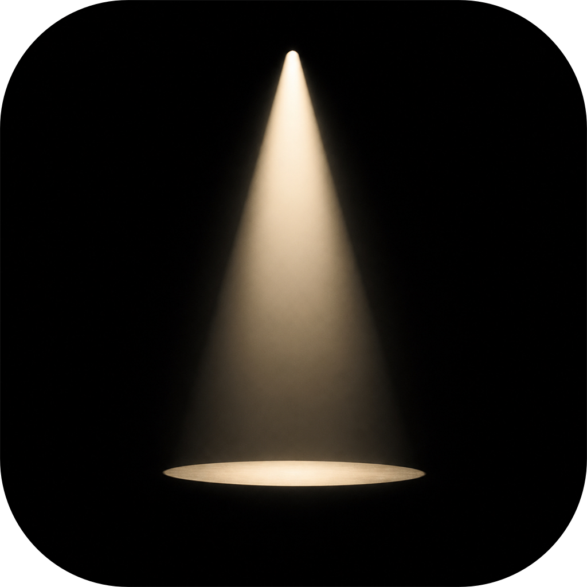

# StageLight / 剧光灯

StageLight is a private, local-first theatre diary for **iPhone and iPad**. Remember the performances you have seen, keep your notes and photos, and share the moments you choose.

> Your life on stage.

[Download on the App Store](https://apps.apple.com/app/id6806575225) · [Website](https://yuanchen.io/StageLight/) · [Version history](CHANGELOG.md) · [Support](https://github.com/chenyuan99/StageLight/issues)

Available in English, 简体中文, 繁體中文, and 日本語.

## Features

- Scan a Playbill, ticket, or theatre poster, review the recognized details, and confirm before saving. Manual entry remains available.
- Record the show, date, theatre, city, time, seat, rating, notes, and photos.
- Browse a visual Collection and chronological Diary, search your records, and view personal theatre statistics.
- Find venues with optional Apple Maps search or enter them manually.
- Keep your diary available across Apple devices with private iCloud sync when available.
- Create Spotlight or Story memory cards, choose the details to include, and share or save them to Photos.
- Explore optional Theatre on This Day entries and share theatre-history cards.

## Mini Theatre and app icons — 1.5.0

Enable **Mini Theatre** from **Profile** to meet the original theatre bunny, collect props through past-performance milestones, and decorate a little stage. It is optional: the diary works without it. Bunny share images exclude your nickname and diary details.

**Golden Premiere** is the default iOS icon in 1.5.0, shown above. **Profile → App icon** also offers Original, Theatre bunny, and Cream bunny. Icon selection does not require enabling Mini Theatre.

### Logo wall

  
  &nbsp;
  
  &nbsp;
  
  &nbsp;
  
  &nbsp;
  

  Golden Premiere (default) · Cream bunny · Theatre bunny · Original · Golden Premiere cat (concept)

Choose among the four app icons in **Profile → App icon**. The cat is a design concept, not a selectable icon; the default remains Golden Premiere bunny.

The latest recorded release status is **1.5.0 (7), submitted for review on October 19, 2026**. At that submission, 1.4.1 was the public version; submission does not mean the update is already available. See the [release record](docs/specs/RELEASE_1.5.0.md) and the App Store for availability.

## Privacy and storage

- No separate StageLight account, advertising, or tracking.
- Diary records are stored on device and can sync through your private iCloud account.
- Mini Theatre progress is stored separately **on this device only**; it does not sync through iCloud.
- Enabling the companion or changing an icon does not reset your diary, photos, notes, or iCloud settings.
- Sharing is user-initiated. Review the selected details before sharing a card.

Read the [privacy policy](PRIVACY.md).

## Product Docs

- [PRD](docs/PRD.md)
- [Localization PRD](docs/LOCALIZATION_PRD.md)
- [Design](docs/DESIGN.md)
- [Technical Specification](docs/TECHNICAL_SPEC.md)
- [Test Plan](docs/TEST_PLAN.md)
- [Mini Theatre specification](docs/specs/MINI_THEATRE_COMPANION.md)
- [App icon specification and device tests](docs/specs/APP_ICON.md)
- [Theatre on This Day specification](docs/specs/THEATRE_ON_THIS_DAY.md)
- [Changelog](CHANGELOG.md)

## Stack

Swift 6 · SwiftUI · SwiftData · PhotosUI · AVFoundation · Vision · URLSession · OSLog · FileManager · XCTest

## Development

Open `StageLight.xcodeproj` in Xcode 16 or later. The app targets iOS 18+ and has no third-party runtime dependencies.

- Run the `StageLight` scheme on an iOS 18+ simulator or device.
- Run unit and UI tests with **Product → Test** (`⌘U`).
- Camera capture requires a physical iPhone; manual entry and PhotosPicker work in Simulator.

## Principles

Local-first. Private by default. No account required. AI assists, user confirms.
